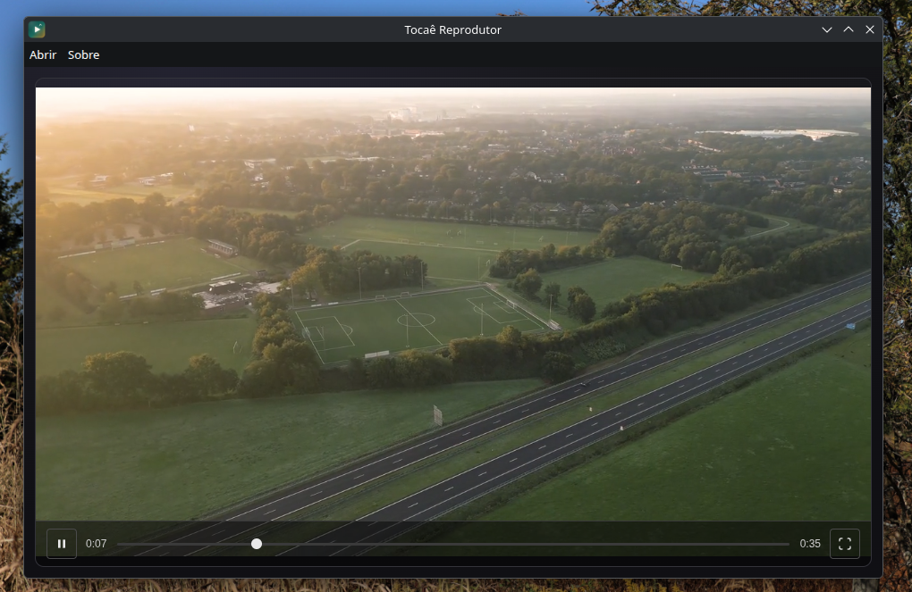

# Tocaê Reprodutor

[Português (Brasil)](README.md) · **English**

Minimalist video player built with Electron, React and TypeScript. It opens a video and plays it without any fuss.



## Features

- Play a list of videos in sequence
- Reorder the playlist by dragging items or with the keyboard
- Jump between videos with single-key shortcuts
- Switch between Portuguese (Brazil) and English at any time

## Languages

The app follows the operating system language on first run and can be changed at any time from the selector in the top bar (also available in the *About* and *Shortcuts* windows).

Available languages: **Portuguese (Brazil)** and **English**. The choice is stored in `settings.json` in the app data directory; the *Follow system* option restores the automatic behaviour.

The texts live in `shared/i18n/messages/`, with the Portuguese catalogue as the source of truth for the keys: the English catalogue is typed from it, so a missing key breaks the build.

## Running from source

```sh
npm install
npm run dev      # Vite dev server
npm run build    # typecheck + bundle + package
```

## Flatpak

The Flatpak manifest lives at `io.github.joaomjbraga.tocae-reprodutor.yaml`.

```sh
flatpak run --command=flathub-build org.flatpak.Builder --install \
  io.github.joaomjbraga.tocae-reprodutor.yaml
```

After changing the npm dependencies, regenerate the dependency manifest (it must run **without** `node_modules` present, otherwise the packages are treated as local sources):

```sh
flatpak-node-generator npm -o generated-sources.json package-lock.json
```

The app requests `--filesystem=host:ro`: it reads the videos from their real path through the `media://` protocol and never writes outside its own data directory.

## Author

[](https://github.com/joaomjbraga)

If you liked it, consider leaving a ⭐ on the repository!
